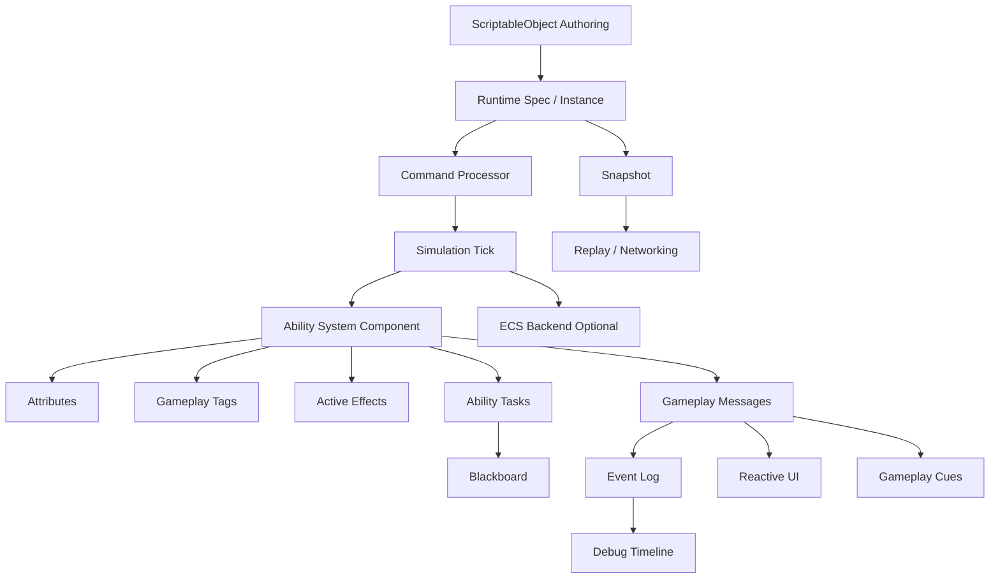

# Unity GAS 可扩展概念详解

本文档是 `Unity-GAS-Architecture.md` 的补充。

主文档关注“如何在 Unity 中实现一套 GAS-inspired 能力系统”。本文档关注更上层的问题：

- 有哪些现代架构概念可以和 GAS 融合？
- 这些概念分别解决什么问题？
- 它们和常见做法有什么区别？
- 为什么不直接用已有的“消息机制”“状态机”“事件”“Update”“AI 行为树”？
- 哪些概念必须早期预留，哪些可以后期再做？
- 在 Unity 里应该怎么落地，才不会把系统做复杂到失控？

这份文档的定位不是“必须全部实现”，而是作为技术地图。后续做框架时，可以按项目规模和战斗复杂度选择性引入。

---

## 1. 概念总览

推荐关注的扩展概念：

```text
Authoring / Runtime Separation
Gameplay Message Bus
Command Pattern
Event Sourcing
Simulation Tick / Presentation Tick
ECS / DOTS
Ability Task
Ability Blackboard
Rule Engine / Condition Tree
Ability Graph
Statechart
Gameplay Ontology
Modifier Algebra
Reactive UI
Asset Baking
Utility AI / GOAP / HTN
Debug Timeline
Snapshot / Replay
Deterministic Simulation
```

这些概念大致可以分成几类：

| 类别 | 概念 |
| --- | --- |
| 数据边界 | Authoring/Runtime、Asset Baking、Snapshot |
| 执行模型 | Simulation Tick、ECS、Command、Deterministic |
| 通信模型 | Gameplay Message Bus、Gameplay Event、Reactive UI |
| 技能编排 | Ability Task、Blackboard、Ability Graph |
| 规则表达 | Rule Engine、Condition Tree、Gameplay Ontology、Modifier Algebra |
| AI 扩展 | Utility AI、GOAP、HTN |
| 调试验证 | Event Sourcing、Debug Timeline、Replay |

---

## 2. 哪些应该一开始预留

### 2.1 强烈建议从第一版就预留

这些后期再补会比较痛：

```text
Authoring / Runtime Separation
GameplayTagDatabase
GameplayTagQuery
Simulation Tick / Presentation Tick
Command Pattern
Gameplay Message Bus / Event Bus
结构化 Event Log
AbilityTask
AbilityBlackboard
IAbilityNetworkAdapter
PredictionKey
Serializable TargetData
Handle-based runtime identity
```

它们不一定要第一版做得很完整，但接口和边界最好早早出现。

### 2.2 可以中期加入

```text
ECS / DOTS backend
Rule Engine
Ability Graph
Asset Baking
Advanced Stacking
Debug Timeline UI
Utility AI
Statechart
```

这些依赖核心模型稳定，太早做会让工作量膨胀。

### 2.3 可以后期加入

```text
Full replay
Network prediction
Server reconciliation
Deterministic rollback
Visual scripting editor
Distributed simulation
Large-scale ECS optimization
```

这些需要明确项目形态之后再决策。

---

## 3. Authoring / Runtime Separation

### 3.1 它是什么

Authoring / Runtime Separation 指的是：编辑器资产和运行时状态必须分离。

在 Unity 中，Authoring 层通常是：

```text
ScriptableObject
Prefab
Inspector 配置
Editor Tool
策划表
```

Runtime 层通常是：

```text
Spec
Instance
Handle
Runtime Container
Snapshot
Command
Event
```

在 GAS 里对应关系是：

```text
GameplayAbilityAsset -> AbilitySpec -> AbilityInstance
GameplayEffectAsset  -> GameplayEffectSpec -> ActiveGameplayEffect
GameplayTagDatabase  -> Runtime TagId / TagContainer
AttributeDefinition  -> Runtime AttributeSet / Aggregator
```

### 3.2 为什么不能直接用 ScriptableObject 跑逻辑

ScriptableObject 是共享资产。

如果你在运行时直接修改它，可能会出现：

- 多个角色共享同一份状态。
- Play Mode 下资产被脏写。
- 存档和回放难做。
- 网络同步无法区分“配置”和“本次实例”。
- 一个技能同时释放多次时状态冲突。

错误倾向：

```text
GA_Fireball.CurrentTarget = enemy
GA_Fireball.IsCasting = true
GE_Poison.RemainingTime = 3.5
```

正确做法：

```text
GA_Fireball 是配置
FireballAbilityInstance 保存本次释放状态
GE_Poison 是配置
ActiveGameplayEffect 保存剩余时间和层数
```

### 3.3 和普通“配置表 + 运行时对象”有什么区别

本质上类似，但在 GAS 中这个边界更严格，因为技能和 Effect 都会生成大量“本次上下文”：

```text
施法者是谁
目标是谁
技能等级是多少
本次伤害倍率是多少
是否暴击
命中位置在哪里
是否本地预测
这次应用的唯一句柄是什么
```

这些都不属于配置资产，而属于 Runtime Spec。

### 3.4 建议落地

第一版就做：

```text
GameplayAbilityAsset
GameplayEffectAsset
AbilitySpec
AbilityInstance
GameplayEffectSpec
ActiveGameplayEffect
AbilityHandle
GameplayEffectHandle
```

并规定：

```text
Asset 不保存运行时状态
Runtime Instance 不反向修改 Asset
所有运行时对象通过 Handle 识别
```

---

## 4. Gameplay Message Bus

### 4.1 它是什么

Gameplay Message Bus 是一个面向玩法语义的消息总线。

它让系统之间通过“玩法消息”通信，而不是互相直接引用。

示例消息：

```text
Message.Ability.Activated
Message.Ability.Ended
Message.Effect.Applied
Message.Effect.Removed
Message.Attribute.Changed
Message.Combat.DamageDealt
Message.Combat.Kill
Message.Input.Confirm
Message.Animation.Event
```

示例数据：

```csharp
public readonly struct GameplayMessage
{
    public GameplayTag MessageTag;
    public AbilitySystemComponent Source;
    public AbilitySystemComponent Target;
    public object Payload;
}
```

### 4.2 它和“消息机制”有什么区别

你完全可以说它就是一种消息机制。区别不在底层技术，而在约束和语义。

普通消息机制可能长这样：

```text
Send("OnDamage", data)
Send("EnemyDead", data)
Send("RefreshUI", data)
Send("PlaySound", data)
```

问题是：

- 命名容易散。
- 事件粒度混乱。
- 逻辑事件和表现事件混在一起。
- 无法被 Tag Query 查询。
- 很难形成统一调试时间线。
- 被动技能、AI、任务、UI、表现层都各玩各的。

Gameplay Message Bus 的重点是：

```text
消息名使用 GameplayTag
消息内容使用明确 Payload 类型
消息语义属于玩法世界
消息可以被日志、回放、调试器统一记录
消息可以被 Ability、Effect、AI、UI、Cue 共同消费
```

所以它不是“另起一套消息机制”，而是给已有消息机制套上 GAS 风格的命名、类型、生命周期和调试约束。

### 4.3 Gameplay Message 和 Gameplay Event 的区别

可以这样分：

```text
Gameplay Event:
  更偏 Ability 内部或 ASC 局部事件
  例如 WaitAnimationEvent、WaitTargetData、WaitInputRelease

Gameplay Message:
  更偏全局或跨系统事件
  例如 DamageDealt、EnemyKilled、QuestProgress、UIRefresh
```

但两者可以共用底层实现。

推荐约定：

```text
Ability 内部等待的叫 GameplayEvent
跨系统广播的叫 GameplayMessage
```

### 4.4 为什么不直接用 C# event / UnityEvent

C# event 适合强类型、局部对象间回调。

UnityEvent 适合 Inspector 绑定表现或简单事件。

但 GAS 需要：

- 按 Tag 分类。
- 动态订阅一类事件。
- 支持层级匹配。
- 支持结构化记录。
- 支持跨系统统一调试。
- 未来支持网络或回放过滤。

这些用裸 C# event 会变得分散。

推荐做法不是抛弃 C# event，而是：

```text
底层可以用 C# event 实现
上层暴露 Gameplay Message Bus 语义
```

### 4.5 什么时候不要用

不要把所有东西都扔到 Bus 上。

不适合：

```text
每帧移动位置同步
高频物理碰撞细节
私有对象内部状态变化
明确的一对一函数调用
```

适合：

```text
有玩法意义的离散事件
需要被多个系统观察的事件
需要记录到调试时间线的事件
需要让被动技能或任务系统监听的事件
```

---

## 5. Command Pattern

### 5.1 它是什么

Command Pattern 指的是把“玩家或系统想做的一件事”封装成一个对象或结构。

不是直接调用：

```csharp
asc.TryActivateAbility(handle);
```

而是创建命令：

```csharp
public readonly struct ActivateAbilityCommand
{
    public EntityId Instigator;
    public AbilityHandle AbilityHandle;
    public PredictionKey PredictionKey;
    public int InputSequence;
}
```

然后提交给系统：

```csharp
commandQueue.Enqueue(command);
```

系统在固定时机处理命令：

```text
Simulation Tick
  -> 读取 CommandQueue
  -> 验证命令
  -> 执行 Ability 激活
  -> 生成 Event Log
```

### 5.2 它解决什么问题

Command 把“意图”和“执行”分离。

玩家按键只是表达意图：

```text
我想释放技能 1
```

系统执行时要判断：

```text
是否还活着
是否被沉默
是否在冷却
资源够不够
目标是否合法
当前 Tick 能不能执行
服务端是否允许
```

### 5.3 和直接调用方法有什么区别

直接调用：

```text
输入系统 -> ASC.TryActivateAbility -> 立即执行
```

优点：

- 简单。
- 直观。
- 适合单机小项目。

缺点：

- 不容易回放。
- 不容易做网络同步。
- 不容易做输入缓冲。
- 不容易做固定 Tick。
- AI、玩家、脚本可能走不同入口。

Command：

```text
输入 / AI / 脚本 -> 创建 Command -> Command Processor -> ASC
```

优点：

- 玩家和 AI 入口统一。
- 可以记录、重放、丢弃、排序。
- 可以发给服务端验证。
- 可以做自动测试。
- 可以做输入缓冲。
- 可以用于录像和回放。

### 5.4 为什么后期补会麻烦

如果早期所有系统都直接调用：

```text
asc.TryActivateAbility()
effect.Apply()
target.TakeDamage()
```

后面想接网络时，你要把所有入口都找出来，再改成命令。

容易漏。

也容易出现：

```text
某些技能走命令
某些技能直接调用
某些 AI 绕过验证
某些测试绕过冷却
```

所以建议第一版就有 Command 概念，哪怕只是很轻量：

```text
LocalCommandQueue
ImmediateCommandProcessor
```

### 5.5 常见 GAS 命令

```text
InputPressedCommand
InputReleasedCommand
ActivateAbilityCommand
CancelAbilityCommand
ConfirmAbilityCommand
SendTargetDataCommand
ApplyGameplayEffectCommand
RemoveGameplayEffectCommand
SendGameplayEventCommand
```

### 5.6 Command 和 Event 的区别

这是很重要的区别：

```text
Command 是“请求做某事”
Event 是“某事已经发生”
```

例如：

```text
ActivateAbilityCommand:
  请求释放火球

AbilityActivatedEvent:
  火球已经成功激活
```

Command 可以失败：

```text
因为冷却中而失败
因为 Mana 不够而失败
因为目标非法而失败
```

Event 不应该失败，因为它是事实记录。

---

## 6. Event Sourcing

### 6.1 它是什么

Event Sourcing 是一种把系统变化记录为事件序列的思想。

在完整 Event Sourcing 架构里，当前状态可以由历史事件重放得到。

对 Unity GAS 来说，不一定要做得这么彻底。更实用的版本是：

```text
结构化战斗事件日志
```

记录关键事实：

```text
00.000 InputPressed Ability1
00.016 AbilityActivated Fireball
00.016 CostCommitted Mana -20
00.016 EffectApplied Cooldown.Fireball
00.420 AnimationEvent Fire
00.450 ProjectileSpawned
00.900 ProjectileHit EnemyA
00.900 EffectApplied FireballDamage
00.900 AttributeChanged Health 100 -> 63
00.900 CueExecuted FireImpact
01.000 AbilityEnded Fireball
```

### 6.2 和普通日志有什么区别

普通日志：

```text
"Fireball hit enemy"
"Damage = 37"
```

主要给人看。

结构化事件：

```csharp
public readonly struct AbilityActivatedEvent
{
    public float Time;
    public EntityId Owner;
    public AbilityHandle Ability;
    public PredictionKey PredictionKey;
}
```

既给人看，也给系统用。

用途：

- Debug Timeline。
- 自动测试断言。
- 战斗回放。
- 性能分析。
- 网络校验。
- 客服排查线上战斗问题。
- 技能平衡数据分析。

### 6.3 为什么不直接打 Debug.Log

`Debug.Log` 的问题：

- 文本不可稳定解析。
- 无法按 Entity / Ability / Effect 查询。
- 无法回放。
- 无法给 UI 时间线使用。
- 发布版本通常会被关闭或裁剪。

建议：

```text
核心系统生成结构化 GameplayEventRecord
开发环境再把它格式化成 Debug.Log
```

### 6.4 早期怎么轻量实现

第一版可以很简单：

```csharp
public interface IGameplayEventRecorder
{
    void Record<T>(T evt) where T : struct, IGameplayEventRecord;
}
```

默认实现：

```text
NullRecorder
MemoryRingBufferRecorder
UnityDebugLogRecorder
```

不要一开始就做完整回放系统。

---

## 7. Simulation Tick / Presentation Tick

### 7.1 它是什么

把“战斗模拟”与“画面表现”拆成两个时间域。

Simulation Tick：

```text
固定频率
处理技能状态
处理 Buff 时间
处理 Cooldown
处理周期 Effect
处理命中判定
处理属性变化
处理 Command
```

Presentation Tick：

```text
每帧
处理动画过渡
处理特效
处理 UI 插值
处理音效
处理镜头
处理表现层平滑
```

### 7.2 为什么不直接全部用 Update

Unity 的 `Update()` 是渲染帧驱动，帧率不稳定。

如果战斗逻辑依赖 `Update()`：

- 30 FPS 和 120 FPS 行为可能不同。
- Buff Tick 时间可能有误差。
- 后续联网难做。
- 回放难做。
- 自动测试不稳定。

推荐：

```text
战斗逻辑用固定步长
表现层用每帧
```

### 7.3 和 FixedUpdate 有什么区别

`FixedUpdate` 是 Unity 物理固定步长回调。

你可以用它驱动 Simulation Tick，但不要把概念绑定死到 FixedUpdate。

更好的抽象：

```csharp
public interface IGameplaySimulationClock
{
    int Tick { get; }
    float FixedDeltaTime { get; }
    float Time { get; }
}
```

然后可以有不同实现：

```text
LocalFixedUpdateClock
ManualTestClock
ServerTickClock
ReplayClock
RollbackClock
```

### 7.4 对 GAS 的影响

这些系统应走 Simulation Tick：

```text
ActiveGameplayEffectContainer.Tick
AbilityTask.Tick
Cooldown Remaining
Periodic Effect
Command Processing
Gameplay Event Dispatch for logic
```

这些走 Presentation Tick：

```text
GameplayCue visual update
UI fill amount smooth interpolation
Animator visual blending
VFX lifetime
Camera shake
Damage number animation
```

---

## 8. ECS / DOTS

### 8.1 它是什么

ECS 是 Entity Component System。

它把对象拆成：

```text
Entity:
  一个 ID

Component:
  纯数据

System:
  批量处理拥有某些组件的 Entity
```

例如：

```text
Entity 1001
  LocalTransform
  AbilityOwner
  AttributeBuffer
  GameplayTagBuffer
  ActiveEffectBuffer
```

System：

```text
GameplayEffectTickSystem
AttributeAggregationSystem
CooldownSystem
AbilityActivationSystem
```

### 8.2 ECS 和 GAS 是什么关系

GAS 是玩法语义模型。

ECS 是运行时数据与执行模型。

它们不是互斥关系。

推荐理解：

```text
GAS 定义“什么是技能、效果、属性、标签”
ECS 定义“这些数据如何高效存储和批量执行”
```

### 8.3 为什么不第一版就全 ECS

纯 ECS 对以下内容会更复杂：

- 技能异步流程。
- 动画事件。
- 复杂 TargetData。
- 编辑器调试。
- ScriptableObject 工作流。
- 面向对象扩展公式。
- 与现有 MonoBehaviour 项目集成。

建议路线：

```text
第一版：MonoBehaviour ASC + 纯 C# Runtime Data
第二版：Effect Tick / Cooldown / Attribute Aggregation ECS 化
第三版：大规模 NPC / Projectile / Aura ECS 化
第四版：联网或确定性需求下再进一步收敛
```

### 8.4 早期如何为 ECS 预留

从第一版就避免：

```text
运行时状态强依赖 GameObject 引用
逻辑直接写在 MonoBehaviour.Update
属性直接是 public float
Effect 内部持有复杂 UnityEngine.Object 状态
TargetData 无法序列化
```

推荐：

```text
EntityId / AbilityActorHandle
GameplayAttributeId
GameplayTagId
GameplayEffectHandle
Serializable TargetData
Runtime Container
Simulation Tick
```

这样以后可以迁移到 ECS Buffer。

---

## 9. Ability Task

### 9.1 它是什么

Ability Task 是技能流程中的异步步骤。

技能不是一帧完成的，它经常需要：

```text
播放动画
等待动画事件
等待输入释放
等待目标选择
等待投射物命中
等待延迟
等待引导结束
等待 Gameplay Event
```

Ability Task 把这些等待过程封装成小模块。

### 9.2 和 Coroutine 有什么区别

Coroutine 可以实现等待，但它有几个问题：

- 生命周期容易散。
- Cancel 复杂。
- 不容易调试当前卡在哪一步。
- 不容易接网络预测。
- 不容易被 Ability Graph 复用。
- 不容易统一 Tick。

Ability Task 的优势：

```text
每个 Task 有明确 Start / Tick / Cancel / End
Ability 结束时统一取消 Task
Task 可以被调试器显示
Task 可以被图节点复用
Task 可以走 Simulation Tick
Task 可以发结构化事件
```

### 9.3 和 async/await 有什么区别

`async/await` 更适合普通异步流程。

但技能系统还需要：

- 可取消。
- 可被调试器枚举。
- 可 Tick。
- 可序列化状态。
- 可接动画和目标系统。
- 可被可视化节点复用。

所以可以底层用 UniTask，但上层仍建议保留 AbilityTask 语义。

---

## 10. Ability Blackboard

### 10.1 它是什么

Blackboard 是一个运行时临时数据板。

AbilityInstance 在释放过程中会产生很多临时值：

```text
Target
TargetPoint
ChargeTime
ComboIndex
HitTargets
DamageMultiplier
ProjectileId
CastStartTime
```

Blackboard 用统一容器保存这些数据。

```csharp
public sealed class AbilityBlackboard
{
    public void Set<T>(string key, T value);
    public bool TryGet<T>(string key, out T value);
    public bool Has(string key);
    public void Remove(string key);
}
```

### 10.2 为什么不直接在 AbilityInstance 上写字段

简单技能可以直接写字段。

但当你引入 AbilityTask 或 AbilityGraph 后，不同节点之间需要共享数据：

```text
SelectTargetTask 输出 Target
PlayAnimationTask 读取 Target 朝向
DamageTask 读取 Target 和 DamageMultiplier
CueTask 读取 HitLocation
```

如果全部写字段：

- 每个技能类字段都不同。
- 通用 Task 很难复用。
- 图节点无法通用传值。
- Debugger 不容易展示。

Blackboard 可以让流程更像数据管线。

### 10.3 风险

Blackboard 的问题是：

- Key 写错不容易发现。
- 类型错误可能运行时才爆。
- 过度使用会变成无类型大杂烩。

建议：

```text
第一版用 string key
中期引入 BlackboardKey<T>
调试器显示所有 key
关键字段尽量有常量定义
```

---

## 11. Rule Engine / Condition Tree

### 11.1 它是什么

Rule Engine 是把“能不能做某事”的条件抽象成可组合规则。

例如：

```text
释放处决技能：
  目标生命低于 30%
  自己在目标背后
  自己没有 State.Stunned
  目标没有 State.Invincible
```

可以表达为：

```text
All:
  CompareAttribute(Target.HealthPercent < 0.3)
  IsBehind(Source, Target)
  SourceHasNone(State.Stunned)
  TargetHasNone(State.Invincible)
```

### 11.2 和 GameplayTagQuery 有什么区别

GameplayTagQuery 只处理标签。

Rule Engine 可以处理更多东西：

```text
Tag
Attribute
Distance
Angle
LineOfSight
Cooldown
Resource
Team
Weapon
Random
Time
ComboState
```

所以关系是：

```text
GameplayTagQuery 是 Rule Engine 的一种基础规则
```

### 11.3 为什么不直接写 if

直接写 if 最简单：

```csharp
if (target.HealthPercent < 0.3f && IsBehind(source, target))
{
    Execute();
}
```

但大量技能后会出现：

- 条件重复。
- 策划不可配置。
- AI 无法复用条件。
- UI 不知道为什么技能不可用。
- 调试器无法展示失败原因。

Rule Engine 可以返回失败原因：

```text
CanActivate = false
Reason:
  Target.HealthPercent must be < 0.3, actual 0.52
```

这对技能 UI 和调试非常有用。

### 11.4 建议落地

第一版不需要复杂 Rule Engine。

可以先定义接口：

```csharp
public interface IGameplayCondition
{
    bool Evaluate(GameplayConditionContext context);
}
```

然后实现少量条件：

```text
TagQueryCondition
AttributeCompareCondition
CooldownReadyCondition
ResourceEnoughCondition
DistanceCondition
```

---

## 12. Ability Graph

### 12.1 它是什么

Ability Graph 是技能流程图。

把技能逻辑从纯 C# 变成节点：

```text
Start
CheckCondition
CommitCost
CommitCooldown
PlayAnimation
WaitAnimationEvent
SelectTarget
SpawnProjectile
ApplyEffect
SendCue
Branch
End
```

### 12.2 和可视化脚本有什么区别

它可以用 Unity GraphView 或其他可视化框架实现，但它不是泛用可视化脚本。

它应该是“领域专用图”：

```text
只服务 Ability 流程
节点都是 GAS 概念
输入输出都是 TargetData、EffectSpec、Tag、Attribute、Blackboard
```

不要做成万能蓝图。万能蓝图成本很高，而且很容易失控。

### 12.3 为什么可以晚点做

Ability Graph 依赖：

```text
AbilityTask
Blackboard
GameplayEvent
TargetData
EffectSpec
Condition
```

这些底层没稳定前，先做图编辑器会反复返工。

推荐：

```text
先 C# Ability
再 Task 化
再 Blackboard 化
最后把 Task 包装成 Graph Node
```

---

## 13. Statechart

### 13.1 它是什么

Statechart 是层级状态机。

普通 FSM：

```text
Idle
Run
Jump
Attack
Dodge
Stun
Dead
```

状态多了以后，转换爆炸。

Statechart 可以分层：

```text
Alive
  Locomotion
    Idle
    Move
    Jump
  Combat
    Attacking
    Casting
    Blocking
    Dodging
  CrowdControl
    Stunned
    Rooted
Dead
```

### 13.2 和 GameplayTag 的关系

GameplayTag 可以表达状态事实：

```text
State.Casting
State.Stunned
State.Dodging
```

Statechart 管理状态转换：

```text
能不能从 Casting 到 Dodging
Stunned 是否打断 Attacking
Dead 是否退出所有 Alive 子状态
```

推荐关系：

```text
Statechart 负责结构化状态流转
GameplayTag 负责让其他系统查询当前状态
```

### 13.3 为什么不只用 Tag

只用 Tag 会遇到：

- 状态之间互斥关系不明确。
- 进入/退出逻辑分散。
- 复杂转换难维护。
- 多个系统同时加减 Tag 可能冲突。

Tag 适合表达“事实”，Statechart 适合表达“状态生命周期”。

### 13.4 什么时候需要

如果你的角色控制简单，不一定需要。

如果有这些需求，就值得考虑：

```text
复杂动作状态
攻击可被闪避取消
施法可被眩晕打断
霸体期间免疫击退
空中和地面技能不同
连招窗口复杂
```

---

## 14. Gameplay Ontology

### 14.1 它是什么

Gameplay Ontology 可以理解为“玩法语义词汇表”。

它定义项目里有哪些玩法概念，以及它们如何分类。

例如：

```text
Damage
  Physical
    Slash
    Pierce
    Blunt
  Elemental
    Fire
    Ice
    Lightning

Control
  Stun
  Root
  Silence
  Knockback

Defense
  Shield
  Armor
  Invincible
  Parry

Movement
  Dash
  Blink
  Leap
```

### 14.2 和 GameplayTag 有什么区别

GameplayTag 是技术载体。

Gameplay Ontology 是设计规范。

Tag 是：

```text
Damage.Fire
State.Stunned
Effect.Buff.Haste
```

Ontology 回答的是：

```text
项目里 Fire 属于 Damage 还是 Element？
Burn 是 Damage 类型还是 Debuff 类型？
Stun 属于 Control 还是 State？
Immune.CrowdControl 能免疫 Knockback 吗？
Shield 是 Attribute、Effect 还是 Defense 语义？
```

### 14.3 为什么要提前做

如果没有语义规范，Tag 会越长越乱：

```text
FireDamage
Damage.Fire
Element.Fire
Burning
State.Fire
Debuff.Burn
Effect.FireDot
```

这些名字可能都指向类似概念，但系统很难知道它们的关系。

Ontology 可以让：

- 技能命名一致。
- AI 判断一致。
- UI 分类一致。
- 免疫和驱散规则一致。
- 数值公式更清晰。

---

## 15. Modifier Algebra

### 15.1 它是什么

Modifier Algebra 是把属性修改规则变成明确的“数值代数”。

不要只模糊地说：

```text
攻击力 +20%
伤害 +20%
最终伤害 +20%
```

要定义它们分别属于哪个乘区或加区。

### 15.2 为什么普通 Add/Multiply 不够

只用：

```text
Add
Multiply
Override
```

很快会有疑问：

```text
两个 +20% 是 1.4 还是 1.44？
装备的攻击力 +20% 和 Buff 的攻击力 +20% 是同一区吗？
最终伤害提高 20% 和火伤提高 20% 怎么叠？
减伤是先加后乘，还是先乘后加？
```

### 15.3 推荐数值通道

可以定义：

```text
BaseAdd
BaseMultiply
PercentAdd
PercentMultiply
FinalAdd
FinalMultiply
Override
ClampMin
ClampMax
```

示例公式：

```text
Value =
  Clamp(
    (((Base + BaseAdd) * BaseMultiply) * (1 + PercentAdd) * PercentMultiply + FinalAdd) * FinalMultiply,
    Min,
    Max
  )
```

### 15.4 好处

- 策划知道每个词是什么意思。
- 技能描述能和实际公式一致。
- Buff 叠加更可控。
- 平衡问题更容易定位。
- Debugger 能显示每个通道贡献。

---

## 16. Reactive UI

### 16.1 它是什么

Reactive UI 指 UI 订阅数据变化，而不是每帧主动轮询。

例如：

```text
HealthChanged -> 血条更新
CooldownChanged -> 技能按钮更新
ActiveEffectAdded -> Buff 图标添加
ActiveEffectRemoved -> Buff 图标移除
TagAdded(State.Stunned) -> 显示控制状态图标
```

### 16.2 和普通 UI 刷新有什么区别

普通做法：

```csharp
void Update()
{
    healthBar.value = character.Health / character.MaxHealth;
}
```

问题：

- 每帧轮询。
- UI 依赖角色内部字段。
- 不知道变化来源。
- 冷却、Buff、Tag 复杂后会乱。

Reactive 做法：

```text
UI 订阅 ASC 的 AttributeChanged / CooldownChanged / EffectChanged
```

好处：

- 解耦。
- 更省。
- 更容易调试。
- 和 GAS 事件模型一致。

### 16.3 是否必须用 UniRx / R3

不必须。

可以用：

```text
C# event
自定义 Observable
UniRx
R3
UnityEvent
```

重点不是库，而是“UI 响应能力系统事件”。

---

## 17. Asset Baking

### 17.1 它是什么

Asset Baking 指把编辑器友好的资产转换成运行时友好的数据。

编辑器资产：

```text
GameplayEffectAsset
  Attribute: "Health"
  Tag: "Damage.Fire"
  Curve: AnimationCurve
```

Baked 数据：

```text
BakedGameplayEffectData
  AttributeId: 1001
  TagId: 2042
  CurveBlob
```

### 17.2 为什么需要

ScriptableObject 对编辑器友好，但运行时不一定最优：

- 字符串查询慢且易错。
- UnityEngine.Object 引用不适合纯模拟。
- ECS Job 不能随便访问托管对象。
- 网络同步需要稳定 ID。
- 回放需要可序列化数据。

### 17.3 可以晚点做吗

可以。

但早期要避免设计成无法 Bake：

```text
运行时状态不要存在 Asset 里
Tag / Attribute 要有稳定 ID
TargetData 要可序列化
EffectSpec 要能快照
```

---

## 18. Utility AI / GOAP / HTN

### 18.1 它们是什么

这些是 AI 决策方法。

Utility AI：

```text
给每个行为打分，选分最高的
```

GOAP：

```text
Goal Oriented Action Planning
根据目标和动作前后条件自动规划步骤
```

HTN：

```text
Hierarchical Task Network
把复杂目标分解成层级任务
```

### 18.2 和 Behavior Tree 有什么区别

Behavior Tree：

```text
程序或策划写好行为树流程
AI 按树执行
```

Utility AI：

```text
AI 根据当前局面评分选择
适合技能选择、战斗反应
```

GOAP：

```text
AI 根据目标自动组合行动
适合生存、策略、潜入、复杂 NPC
```

HTN：

```text
介于行为树和规划之间
适合复杂但可控的任务分解
```

### 18.3 和 GAS 如何结合

AI 不应该有一套独立技能逻辑。

AI 应该查询 ASC：

```text
CanActivateAbility
GetCooldownRemaining
GetAttribute
HasTag
EstimateAbilityUtility
GetValidTargets
```

Utility AI 示例：

```text
Fireball Score =
  距离合适度
  目标是否聚集
  自己 Mana 是否足够
  目标是否怕火
  冷却是否完成

Heal Score =
  队友血量越低分越高
  自己是否安全
  治疗技能冷却是否完成
```

### 18.4 为什么这对 GAS 重要

如果玩家和 AI 都走同一套 Ability：

- 技能规则一致。
- Buff 对 AI 也生效。
- 沉默、眩晕、冷却不需要重复写。
- 平衡更统一。
- Debugger 能同时看玩家和 AI。

---

## 19. Debug Timeline

### 19.1 它是什么

Debug Timeline 是战斗事件的时间线视图。

它展示某个角色或某次技能释放中发生了什么：

```text
Tick 100 | InputPressed Ability1
Tick 101 | AbilityActivated GA_Fireball
Tick 101 | Cost Mana 50 -> 30
Tick 101 | Cooldown.Fireball Added
Tick 125 | Animation Event Fire
Tick 128 | Projectile Spawned
Tick 160 | Projectile Hit EnemyA
Tick 160 | Damage 37
Tick 160 | EnemyA Health 100 -> 63
Tick 161 | Cue FireImpact
Tick 170 | AbilityEnded GA_Fireball
```

### 19.2 为什么它重要

复杂技能的问题通常不是“代码崩了”，而是：

```text
为什么技能没放出来？
为什么扣了蓝但没造成伤害？
为什么冷却没结束？
为什么眩晕没有打断施法？
为什么 Buff 移除后移速没恢复？
为什么 UI 显示和实际状态不一致？
```

Debug Timeline 可以直接看到流程在哪一步出了问题。

### 19.3 和普通 Inspector 的区别

Inspector 看当前状态。

Timeline 看历史过程。

两者都需要：

```text
Inspector:
  现在有什么 Attribute / Tag / Effect / Ability

Timeline:
  它们是如何变成现在这样的
```

---

## 20. Snapshot / Replay

### 20.1 Snapshot 是什么

Snapshot 是某一刻的系统状态快照。

例如：

```text
Attributes
Owned Tags
Active Effects
Ability States
Cooldowns
Simulation Tick
Random Seed
```

### 20.2 Replay 是什么

Replay 是用命令或事件重放战斗。

两种路线：

```text
Command Replay:
  记录玩家和 AI 输入命令
  重新模拟得到结果

Event Replay:
  记录已经发生的结果事件
  按事件回放表现
```

Command Replay 更适合验证和联网。

Event Replay 更适合展示和战斗记录。

### 20.3 为什么现在要预留

不需要第一版实现 Replay。

但要预留：

```text
Command
Event Log
Simulation Tick
Stable Handle
Serializable Snapshot
Deterministic Random placeholder
```

否则后期要重做很多入口。

---

## 21. Deterministic Simulation

### 21.1 它是什么

Deterministic Simulation 指同样输入在不同机器上得到完全相同结果。

它通常用于：

```text
帧同步
回滚网络
录像校验
服务端验证
大规模战斗回放
```

### 21.2 Unity 默认不是确定性的

需要小心：

- float 计算不同平台可能有差异。
- Unity Physics 不保证完全确定。
- Update 帧率不同。
- Random 如果不统一 seed 会不同。
- 对象遍历顺序可能不稳定。

### 21.3 和 GAS 的关系

如果未来要帧同步，GAS 系统需要：

```text
固定 Tick
确定性随机
稳定排序
可序列化 Command
可快照状态
避免非确定性物理参与权威逻辑
```

如果未来只是普通服务器权威，确定性要求可以低很多。

---

## 22. 概念之间的关系图



---

## 23. 推荐最小预留接口

### 23.1 Command

```csharp
public interface IGameplayCommand
{
    int Tick { get; }
    EntityId Instigator { get; }
}
```

### 23.2 Event Record

```csharp
public interface IGameplayEventRecord
{
    int Tick { get; }
    GameplayTag EventTag { get; }
    EntityId Source { get; }
    EntityId Target { get; }
}
```

### 23.3 Message Bus

```csharp
public interface IGameplayMessageBus
{
    void Publish<T>(GameplayTag tag, T payload);
    IDisposable Subscribe<T>(GameplayTag tag, Action<T> handler, TagMatchType matchType);
}
```

### 23.4 Simulation Clock

```csharp
public interface IGameplaySimulationClock
{
    int Tick { get; }
    float FixedDeltaTime { get; }
    float ElapsedTime { get; }
}
```

### 23.5 Blackboard

```csharp
public interface IAbilityBlackboard
{
    void Set<T>(BlackboardKey<T> key, T value);
    bool TryGet<T>(BlackboardKey<T> key, out T value);
}
```

### 23.6 Network Adapter Placeholder

```csharp
public interface IAbilityNetworkAdapter
{
    bool IsAuthority { get; }
    PredictionKey CreatePredictionKey();
    void SubmitCommand(IGameplayCommand command);
}
```

---

## 24. 对当前 Unity GAS 项目的建议

如果现在从零开始做，建议第一版就这样定：

```text
1. 所有技能入口都走 Command Processor。
2. 所有战斗逻辑都走 Simulation Tick。
3. 所有配置资产和运行时实例严格分离。
4. 所有状态、分类、事件命名都走 GameplayTag。
5. AbilityInstance 自带 Blackboard。
6. Ability 流程由 AbilityTask 组织。
7. ASC 内置 Message Bus 或接入局部 Message Bus。
8. 每个关键动作都生成结构化 Event Record。
9. 网络相关先用 LocalNetworkAdapter 空实现。
10. 数据结构尽量可序列化、可快照、可批处理。
```

暂时不要做：

```text
完整 ECS 化
复杂 Ability Graph 编辑器
完整回放系统
完整网络预测
复杂规则引擎 UI
```

这样可以保持第一版能落地，同时不会把未来的大门堵死。

---

## 25. 一句话总结

这些概念并不是为了把系统做得更“高级”，而是为了让系统在变复杂时仍然保持可解释、可测试、可调试、可扩展。

对于 Unity 版 GAS，最重要的不是一开始实现所有概念，而是从第一天就建立正确边界：

```text
配置和运行时分离
请求和事实分离
逻辑和表现分离
语义和执行分离
当前状态和历史过程分离
```

只要这些边界立住，后续无论接 ECS、AI、联网、回放、可视化编辑器，都会轻很多。

